<div align="center">

# PGT-AI

### Parotid gland tumour classification from multi-parametric MRI

**Head-and-neck MRI preprocessing · multi-slice × multi-sequence deep learning · leak-aware validation · STARD-style reporting**

[](.github/workflows/ci.yml)


</div>

---

## Overview

Parotid tumours are mostly benign, but the subtype changes management. Pleomorphic
adenomas are usually resected because of their malignant-transformation risk. Warthin
tumours are often observed. The roughly one-in-five malignant lesions need oncological
surgery. Fine-needle aspiration is non-diagnostic in a meaningful share of cases, so
pre-operative MRI is central to the work-up.

This repository is the code of the MD thesis *"Classifying Parotid Gland Tumors Using
Multimodal MRI and Deep Learning"*. It contains:

1. **A head-and-neck mpMRI preprocessing pipeline.** It takes raw clinical PACS exports
   to lesion-centred, physically consistent tensors. It handles vendor-specific series
   names, 3-D and 4-D diffusion exports, structural and diffusion grids with different
   resolutions, and 3D Slicer fiducials. QC is built in.
2. **A four-step model-development engine.** It goes from single-sequence screens to
   fused multi-slice × multi-sequence models: ResNet-18, gated-attention MIL, and
   sequence attention. Every selection rule is implemented in code.
3. **A held-out evaluation.** A 5-checkpoint ensemble with calibrated probabilities,
   bootstrap CIs, paired DeLong tests, per-class metrics, and Grad-CAM + attention
   dashboards.

Two tasks are modelled: **benign vs malignant** (n = 274) and **benign subtype**
(pleomorphic adenoma / Warthin / other benign).

## Results (held-out test set, evaluated once)

The primary model for each task was fixed by cross-validation **before** the sealed 15 %
test set was opened. Values are point estimates with 95 % bootstrap CIs (2000 resamples).

<table>
<tr><th>Benign vs malignant</th><th>Benign subtype</th></tr>
<tr><td>

**Early fusion (B0 + DWI + T1c)**, 5 slices · n = 42 (9 malignant)<br>
temperature 0.972 · threshold 0.414 (fixed on development data)

| Metric | Value (95 % CI) |
|---|---|
| **AUC** | **0.93 (0.83–0.99)** |
| Sensitivity | 0.89 (0.62–1.00) |
| Specificity | 0.79 (0.65–0.92) |
| PPV | 0.53 (0.28–0.80) |
| NPV | 0.96 (0.87–1.00) |
| Accuracy | 0.81 (0.69–0.93) |

| | pred. benign | pred. malignant |
|---|---|---|
| **benign** | 26 | 7 |
| **malignant** | 1 | 8 |

</td><td>

**Early fusion (T2 + T1 + ADC)**, 5 slices · n = 33<br>
temperature 1.117 · argmax

| Metric (macro) | Value (95 % CI) |
|---|---|
| **AUC** | **0.95 (0.89–0.99)** |
| Sensitivity | 0.82 (0.66–0.94) |
| Specificity | 0.91 (0.85–0.97) |
| PPV | 0.81 (0.66–0.93) |
| NPV | 0.90 (0.83–0.97) |
| Accuracy | 0.82 (0.70–0.94) |

| Class (n) | AUC | Sens | Spec |
|---|---|---|---|
| Pleomorphic adenoma (17) | 0.95 | 0.82 | 0.94 |
| Warthin (8) | 0.98 | 0.75 | 0.96 |
| Other benign (8) | 0.92 | 0.88 | 0.84 |

</td></tr>
</table>

<p align="center"></p>

**How to read these numbers**

* **With 42 test patients the intervals are wide** (PPV 0.28–0.80). These are
  descriptive estimates for this cohort, not a deployable operating point.
* **Fusion vs the best single sequence.** For subtyping, fusion beat T2 alone
  (ΔAUC +0.10, 95 % CI +0.01 to +0.21, paired bootstrap p = 0.021). For malignancy it did
  **not** significantly beat B0 alone (ΔAUC +0.07, CI −0.07 to +0.23, DeLong p = 0.37).
  The fused model is kept because it reads the sequences a radiologist reads, and its
  performance is described as *comparable*, not *better*.
* **Adding age, sex and laterality changed AUC by less than 0.02** in both tasks (not significant).
* **Cross-validation vs test.** AUC rose from 0.812 → 0.930 (binary) and 0.881 → 0.949
  (subtype). The CV figure scores single models and its epoch was chosen on the reported
  fold, so it is optimistic for model selection yet still lower than the ensemble on the
  test set. The evaluation code also reports single-model test AUCs, the like-for-like
  comparison ([code review #8](docs/CODE_REVIEW.md#8--test-auc-above-cv-auc-medium-interpretation)).

<details><summary><b>All evaluated configurations and paired comparisons</b></summary>

| Task | Role | Model | AUC | Sens | Spec | PPV | NPV | Acc |
|---|---|---|---|---|---|---|---|---|
| binary | **primary** | Early fusion (B0 + DWI + T1c) | 0.93 | 0.89 | 0.79 | 0.53 | 0.96 | 0.81 |
| binary | alt. sequences | Early fusion (B0 + DWI + ADC) | 0.87 | 0.89 | 0.73 | 0.47 | 0.96 | 0.76 |
| binary | + clinical | Early fusion + clinical (B0 + DWI + T1c) | 0.93 | 0.78 | 0.91 | 0.70 | 0.94 | 0.88 |
| binary | single sequence | B0, 5 slices | 0.86 | 0.89 | 0.63 | 0.40 | 0.96 | 0.69 |
| subtype | **primary** | Early fusion (T2 + T1 + ADC) | 0.95 | 0.82 | 0.91 | 0.81 | 0.90 | 0.82 |
| subtype | alt. sequences | Mid fusion (T2 + T1 + T1c) | 0.95 | 0.77 | 0.90 | 0.81 | 0.91 | 0.82 |
| subtype | + clinical | Early fusion + clinical (T2 + T1 + ADC) | 0.96 | 0.83 | 0.93 | 0.83 | 0.92 | 0.85 |
| subtype | single sequence | T2, 5 slices | 0.85 | 0.73 | 0.86 | 0.73 | 0.85 | 0.73 |

| Task | Comparison (same patients) | ΔAUC [95 % CI] | p (bootstrap) | p (DeLong) |
|---|---|---|---|---|
| binary | fused vs B0 | +0.068 [−0.067, +0.228] | 0.371 | 0.367 |
| binary | B0+DWI+T1c vs B0+DWI+ADC | +0.058 [−0.061, +0.194] | 0.345 | 0.358 |
| binary | image-only vs + clinical | +0.004 [−0.045, +0.068] | 1.000 | 0.899 |
| subtype | fused vs T2 | +0.099 [+0.013, +0.210] | 0.021 | — |
| subtype | early T2+T1+ADC vs mid T2+T1+T1c | −0.002 [−0.065, +0.064] | 0.931 | — |
| subtype | image-only vs + clinical | −0.013 [−0.055, +0.020] | 0.482 | — |

Exploratory and unadjusted for multiplicity. Full CIs: [`docs/results/thesis_test_results.json`](docs/results/thesis_test_results.json),
which `pytest` cross-checks against the confusion matrices and this README.
</details>

## Pipeline

```mermaid
flowchart LR
    subgraph P["Preprocessing (src/pgt_ai/preprocessing)"]
        A["PACS ZIP exports"] -->|"group by SeriesInstanceUID<br/>keyed pseudonyms"| B["case / series DICOM"]
        B -->|"dcm2niix · rule-based series classifier<br/>axial check · 4-D/3-D DWI → B0 + high-b"| C["T1 · T2 · T1c · B0 · DWI · ADC<br/>(NIfTI)"]
        C --> D["voxel-spacing audit<br/>(Tukey fences)"]
        C -->|"RAS · MI registration to T1c<br/>N4 · Li/log-Otsu masks · z-score<br/>ADC kept quantitative"| E["registered volumes"]
        F["3D Slicer fiducial<br/>(LPS → RAS)"] --> G
        E --> G["physical 64 mm ROI per grid<br/>valid-z detection · zero padding<br/>radiological orientation"]
        G --> H[("(11, 224, 224) tensors<br/>+ QC sheets + z-alignment manifest")]
    end
    subgraph M["Model development: 5-fold CV on 232 cases"]
        H --> S1["Step 1<br/>1 sequence · centre slice"]
        S1 -->|"encoder warm-start"| S2["Step 2<br/>1 sequence · 5 slices<br/>gated-attention MIL"]
        S1 & S2 --> N{{"consensus rank<br/>+ modality rule"}}
        N -->|"≥ 2 sequence triples"| S3["Step 3<br/>3 sequences · 1 slice<br/>early / late / seq-attention"]
        S3 -->|"encoder + attention<br/>warm-starts"| S4["Step 4<br/>3 sequences · 5 slices<br/>early / mid / late / joint ± clinical"]
    end
    subgraph E2["Held-out test: 42 cases, opened once"]
        S4 -->|"primary model fixed by CV"| T["5-checkpoint ensemble<br/>pooled-OOF temperature + Youden t*"]
        T --> R["bootstrap CIs · paired DeLong<br/>per-class metrics · Grad-CAM + attention"]
    end
```



<p align="center"></p>

<!-- FIGURE PLACEHOLDER: pipeline overview / cohort flow (386 screened → 274 included → 232 / 42).
     Export your presentation figure WITHOUT patient images, or use an ethics-approved version:
     <p align="center"></p> -->

### Interpretability

Every Grad-CAM map is shown **next to the unmodified slice it was computed on**, with the
slice-attention weight per slice and (for sequence-attention models) the per-patient
sequence weighting. Heat-maps and weights are averaged over the five fold models.

<p align="center"></p>
<p align="center"><sub>Synthetic phantom shown (no patient data in this repository).</sub></p>

<!-- FIGURE PLACEHOLDER: Grad-CAM case gallery on real test cases (results/figures/CaseGallery_*.pdf).
     Publish only with ethics approval; titles must read "Case k", never an ID. -->

## Engineering and methodological highlights

| | What | Why it matters |
|---|---|---|
| 🔒 | **Sealed test set**, split before any modelling and opened once | Primary-model performance is an unbiased estimate |
| 🧪 | **Leak-free ADC scaling**: percentiles fit inside every training fold | ADC is quantitative and not z-scored per patient; a cohort scaler fit outside CV would leak validation intensities |
| ⚖️ | **Fold-local class weights** (focal loss) and a **pooled out-of-fold Youden threshold** | No in-sample calibration |
| 🧭 | **Consensus sequence nomination** (average rank of the single- and multi-slice screens, plus a modality-heterogeneity rule), implemented as code | Auditable choice instead of a manual one; always ≥ 2 configurations so "fusion helps" is not confused with "this triple helps" |
| 🔁 | **Component-wise warm starts**: encoder ← previous step, slice attention ← Step 2, sequence attention ← Step 3, joint attention ← both | Small data (n = 232): each head starts from what an earlier step already learned |
| 🧩 | **Sequence attention and joint slice × sequence attention** | Per-patient sequence trust, and a non-factorised control for the late/mid orderings |
| ↔️ | **Laterality-consistent augmentation**: one transform per patient for all sequences; flips also flip the side feature | Keeps co-registration and keeps the clinical input truthful |
| 📏 | **Equal epoch budgets**, per-fold provenance logging, OOF predictions saved | Fair comparisons; paired tests without re-inference |
| 📊 | **Paired DeLong + paired bootstrap**, per-class metrics, reliability diagrams | STARD vocabulary; honest small-sample statistics |
| ✅ | **Bit-identical refactor**: state-dict fingerprints and logits checked against the thesis notebooks | Thesis checkpoints load with `strict=True` |
| 🛡️ | **Privacy by default**: keyed pseudonyms, anonymised figure titles, `tools/phi_scan.py` in pre-commit and CI | No record number, path or image can reach the repository |

A full self-review, including the **limitations a reviewer will raise** (cross-grid slice
alignment, outer-fold epoch selection, test-time ADC scaler), is in
[`docs/CODE_REVIEW.md`](docs/CODE_REVIEW.md).

## Quick start (no patient data needed)

```bash
git clone https://github.com/<your-github-user>/pgt-ai.git && cd pgt-ai
conda env create -f environment.yml && conda activate pgt-ai     # or: pip install -r requirements.txt
pip install -e .

pytest                                          # 95 unit + integration tests (CPU, < 1 min)
python scripts/demo_forward_pass.py --gradcam demo.png           # both primary architectures, synthetic case
python scripts/run_synthetic_pipeline.py --tiny --out synthetic_run   # full pipeline, 64-px phantoms (~8 min CPU)
python scripts/run_synthetic_pipeline.py --out synthetic_run          # NIfTI → ROI → Steps 1–4 → evaluation (~30 min CPU)
```

The forward-pass demo needs no network access: ImageNet weights are not downloaded
(`pretrained=False`). Use `--checkpoint` to load trained weights. The synthetic pipeline
builds phantoms on the thesis grid geometry (0.5 × 0.5 × 5 mm structural,
1 × 1 × 3.85 mm diffusion) with 3D Slicer fiducials, and runs **every** stage, from ROI
export to the final report, case galleries and paired tests. Synthetic numbers say
nothing about real-data performance.

## Running on your own data

```bash
export PGT_PSEUDONYM_KEY=...                       # secret; keeps case IDs stable and non-reversible
export PGT_DATA_ROOT=/secure/parotid PGT_WORK_DIR=/secure/work PGT_RESULTS_DIR=/secure/results

python scripts/preprocess.py ingest   --zips /secure/zips --out /secure/dicom --id-map /secure/keys/id_map.csv
python scripts/preprocess.py convert  --dicom /secure/dicom --tmp /secure/tmp --out /secure/nifti
python scripts/preprocess.py audit    --nifti /secure/nifti --xlsx /secure/spacing_audit.xlsx
#  ... spatial/intensity standardisation (see docs/PREPROCESSING.md, stage 4) ...
python scripts/preprocess.py extract  --struct /secure/prep --diff /secure/prep --out $PGT_DATA_ROOT/parotid_dataset

python scripts/train.py    --config configs/thesis.yaml --split        # freeze the 85/15 split once
python scripts/train.py    --config configs/thesis.yaml --step all     # Steps 1–4 (GPU recommended)
python scripts/evaluate.py --config configs/thesis.yaml                # open the test set once
```

`configs/thesis.yaml` reproduces the thesis protocol. `configs/recommended.yaml` switches
to leak-free epoch selection (SWA) and per-fold test-time ADC scaling. File formats are
described in [`docs/DATA_FORMAT.md`](docs/DATA_FORMAT.md). The three
[`notebooks/`](notebooks) are thin walkthroughs over the same package code.

## Repository layout

```
src/pgt_ai/
  preprocessing/   dicom_ingest · series_classifier · nifti_convert · spacing_audit · spatial_intensity · roi_extraction
  data/            cohort (audits, frozen split) · datasets · intensity (ADC scaler) · transforms · synthetic
  models/          encoders · attention (gated MIL, joint) · architectures (8) · factory · warm_start
  training/        losses · engine (CV) · selection (consensus, nomination) · pipeline (Steps 1–4) · results_io
  evaluation/      metrics · bootstrap · stats (DeLong) · calibration · ensemble · interpretability · plots · reporting
scripts/  configs/  notebooks/  tests/  docs/  tools/  assets/
```

How every notebook cell maps to a module: [`docs/ARCHITECTURE.md`](docs/ARCHITECTURE.md).

## Reproducibility and reporting

* **Determinism.** One seed per (experiment, task, fold) from SHA-256, plus seeded
  DataLoader workers and generators, plus deterministic cuDNN. The thesis run used Python
  `hash()`, which is salted per process, so the archived checkpoints are the artifact of
  record ([review #6](docs/CODE_REVIEW.md#6--hash-seeds-medium)).
* **Provenance.** Every results row records step, architecture, fusion type, epoch
  selection, the epoch kept, the threshold source and the trainable parameter count.
* **Reporting.** [`docs/METHODS.md`](docs/METHODS.md) maps the study to STARD 2015 and
  CLAIM items and lists what still needs adding (e.g. baseline characteristics per split).
* **Test-suite.** It covers geometry (LPS→RAS, physical boxes, radiological orientation,
  valid-z, padding), leakage (the ADC scaler ignores held-out cases), statistics (DeLong vs
  bootstrap, point estimate vs bootstrap mean), checkpoint fingerprints, a tiny end-to-end
  CV run, and the numbers in this README.

## Limitations

Single centre, retrospective, no external validation. A small test set (9 malignant
cases). A heterogeneous "other benign" class. A radiologist-placed fiducial is required at
inference. Cross-validated figures are model-selection evidence. Grad-CAM is qualitative.
See [`docs/MODEL_CARD.md`](docs/MODEL_CARD.md). **Not a medical device.**

## Data and weights availability

Patient data cannot be shared under the study's ethics approval. Trained weights:
*[to be decided, see [`docs/PUBLISHING_CHECKLIST.md`](docs/PUBLISHING_CHECKLIST.md) D]*.

## Citation

```bibtex
@phdthesis{pirahesh_pgt_ai,
  author = {Pirahesh, Kasra},
  title  = {Classifying Parotid Gland Tumors Using Multimodal MRI and Deep Learning},
  school = {<University>},
  type   = {MD thesis},
  year   = {<year>}
}
```

See also [`CITATION.cff`](CITATION.cff). Released under the Apache-2.0 license.
